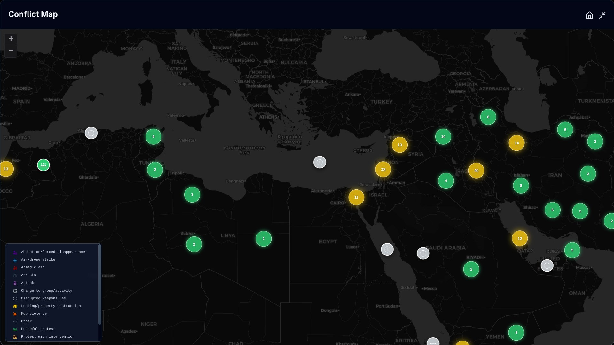
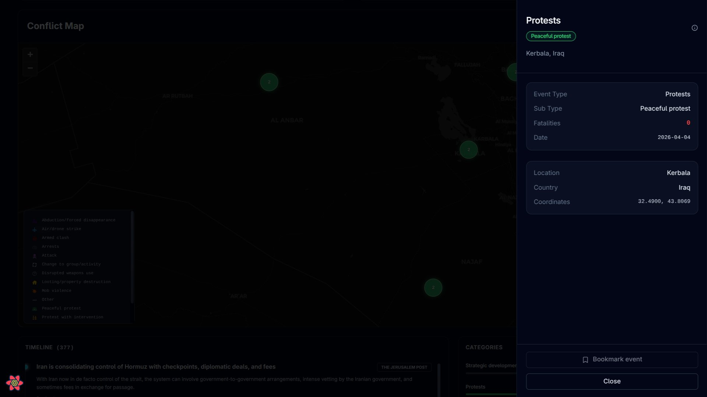
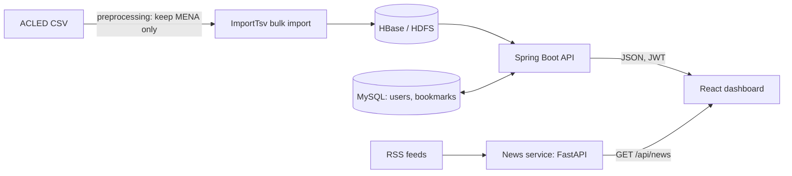

# Falcon Eye

**An interactive platform for exploring conflict events and regional trends across the Middle East and North Africa.**

Falcon Eye brings more than 400,000 public ACLED events into a map and analytics dashboard. Built as a JEE and Big Data project at ENSAM Casablanca, it combines a React frontend with a Spring Boot API, HBase event storage, and a MySQL-backed user system.

## Project demo (AWS EC2 instance free trial has expired)

https://github.com/user-attachments/assets/9c916c10-283b-4c59-ad1a-a66cf478df46

## Features

- **Interactive conflict map** with clustered, color-coded markers and an event detail panel.
- **Operational snapshot** of event counts, affected countries, trend, fatalities, and population exposure.
- **Country analysis dashboard**: totals, yearly trends, event-type and sub-event breakdowns, and regional comparison.
- **Advanced filters** by region, country, event type, and date range.
- **MENA news timeline** from a separate FastAPI service that aggregates RSS feeds, with article details that link back to the original source.
- **Bookmarks** for events and news articles, saved per user.
- **Authentication** with JWT and two roles.

## Screenshots

### Conflict map and event details

### Analytics and news

## Architecture

The React dashboard talks to two backends. The Spring Boot API serves events, statistics, authentication, and bookmarks. The news service is a separate, standalone API: the frontend calls it directly, and bookmarking an article saves it through the Spring Boot API.

## Tech stack

| Area           | Technologies                               |
| -------------- | ------------------------------------------ |
| Frontend       | React, TypeScript, Vite, Leaflet           |
| Backend        | Java 11, Spring Boot, Spring Security, JWT |
| Data           | HBase, HDFS, MySQL, ACLED                  |
| Ingestion      | ImportTsv (bulk import into HBase)         |
| News service   | Python, FastAPI, RSS                       |
| Infrastructure | Docker                                     |

## Data

Events come from [ACLED](https://acleddata.com) (Armed Conflict Location & Event Data Project).

**Preprocessing:** the raw export is filtered before loading so that only relevant records remain.

- Countries outside the MENA region are removed.
- Unrelated events are removed. **TODO:** state exactly which event types or rows you dropped and why, plus the row counts before and after.

Key columns used: `WEEK`, `COUNTRY`, `ADMIN1`, `EVENT_TYPE`, `SUB_EVENT_TYPE`, `FATALITIES`, `EVENTS`, `POPULATION_EXPOSURE`, `CENTROID_LATITUDE`, `CENTROID_LONGITUDE`.

**News:** the news service reads RSS feeds and returns headlines, short summaries, and links. **TODO:** list the feeds or outlets it aggregates.

> **The dataset is not included in this repository.** 

## Limitations and future work

- Data is **bulk-loaded** from ACLED. There is no live event ingestion yet.
- Analytics are computed on demand from HBase. A batch or streaming layer (for example Spark or Kafka) could add pre-computed risk scores and trend prediction.
- The AWS deployment is no longer running (free trial has expired), so the demo video above is the best way to see the app.

