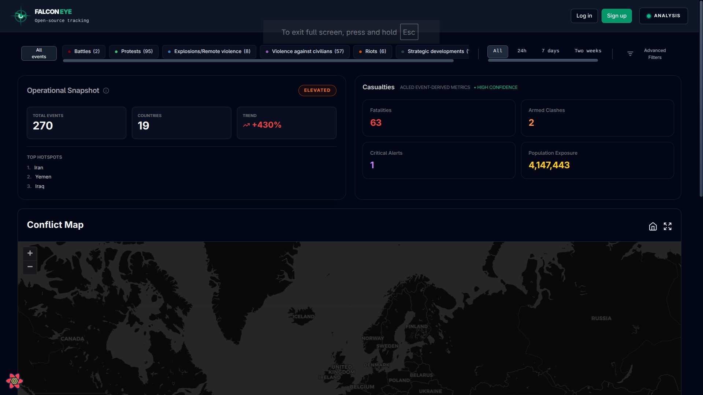
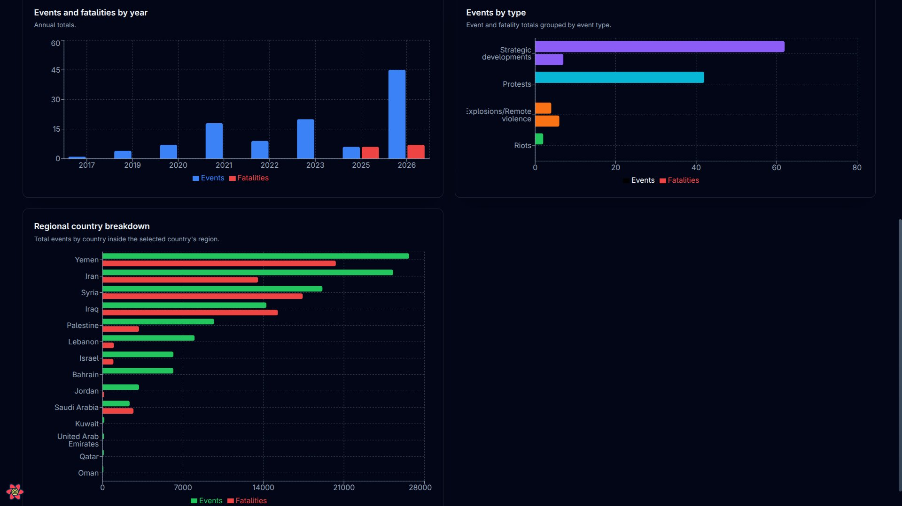
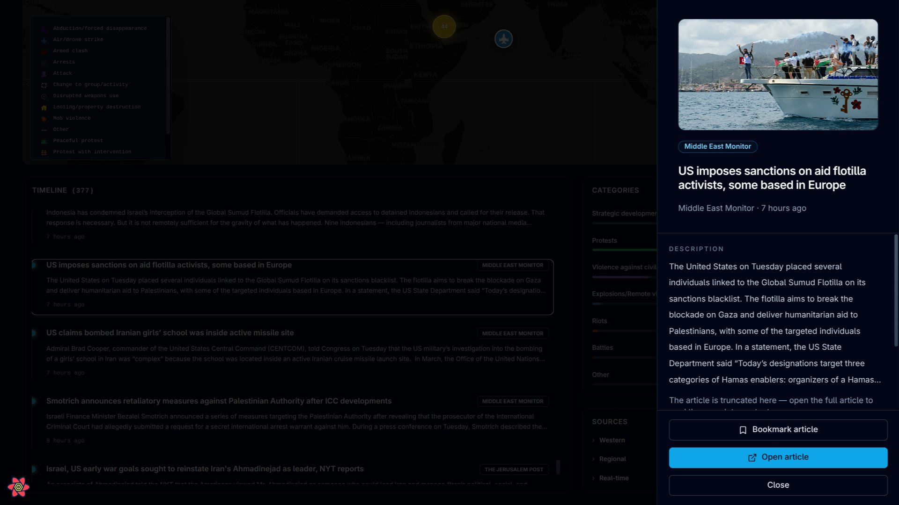

# Falcon Eye

**An interactive platform for exploring conflict events and regional trends across the Middle East and North Africa.**

Falcon Eye brings more than 400,000 public ACLED events into a map and analytics dashboard. Built as a JEE and Big Data project at ENSAM Casablanca, it combines a React frontend with a Spring Boot API, HBase event storage, and a MySQL-backed user system.

## Project demo

<video controls playsinline width="100%" poster="image.png" title="Falcon Eye project demo">
	<source src="falcon-eye%20video.mp4" type="video/mp4">
</video>

## What it does

- Maps conflict events with clustered markers and event details.
- Summarizes event counts, affected countries, fatalities, and population exposure.
- Explores country-level trends, event types, and regional comparisons.
- Filters events by region, country, type, and date.
- Displays a MENA news timeline with article links.
- Supports user accounts, event and news bookmarks

## Screenshots

### Conflict map and event details

### Analytics and news

## Architecture and technology

ACLED event data is prepared for bulk import into HBase. The Spring Boot API reads event data and statistics from HBase, while MySQL stores user accounts and bookmarks. The React dashboard communicates with the API and a separate Python/FastAPI news service, which aggregates RSS feeds.

| Area           | Technologies                               |
| -------------- | ------------------------------------------ |
| Frontend       | React, TypeScript, Vite, Leaflet           |
| Backend        | Java 11, Spring Boot, Spring Security, JWT |
| Data           | HBase, HDFS, MySQL, ACLED                  |
| News service   | Python, FastAPI, RSS                       |
| Infrastructure | Docker                                     |

Country-level analytics use HBase row-key prefix scans to read a country's events and compute summaries on demand.

## Project

Developed for the JEE & Big Data project in the Big Data & IoT Master's program at ENSAM Casablanca, 2025-2026.

Event data is from [ACLED](https://acleddata.com). The dataset is not included in this repository.

## Authors

- **Yassine Yahyawi**: [GitHub](https://github.com/Yahyawi99)
- **Zakaria Bettar**
