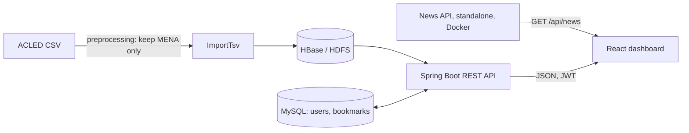

# Falcon Eye

**OSINT analysis of conflicts and threats in the MENA region.**

Falcon Eye is a full-stack platform that turns 400,000+ public conflict events into an interactive map and analytics dashboard. It combines a Hadoop/HBase data layer with a Spring Boot REST API and a React frontend.

> Built as the *JEE & Big Data* project of the Big Data & IoT Master's program at ENSAM Casablanca (2025-2026).

<!-- TODO: add a hero screenshot or GIF of the conflict map here -->
<!--  -->

**Demo video:** TODO add link (the AWS deployment has expired, so a short screen recording is the best way to see it running)

---

## Features

- **Interactive conflict map** with clustered, color-coded markers and an event detail panel
- **Operational snapshot**: total events, affected countries, trend, fatalities and population exposure
- **Analysis dashboard** per country: totals, yearly trends, event-type and sub-event breakdowns, regional comparison
- **Advanced filters** by region, country, event type and date range
- **News timeline** fed by a standalone, containerized news API that scrapes MENA conflict coverage from major newspapers, with an article detail view that links back to the original source
- **Bookmarks** for events and news articles, saved per user
- **JWT authentication** with two roles (`USER`, `ADMIN`) and an admin area for user management

## Architecture



The backend follows a layered structure (controllers, services, repositories, models) with cross-cutting `security` and `config` packages.

## Tech stack

| Layer | Technologies |
|---|---|
| Data storage | HDFS, HBase |
| Ingestion | ImportTsv (bulk load) |
| Backend | Java, Spring Boot, Spring Security, Spring Data JPA, JWT |
| Relational DB | MySQL (users and bookmarks) |
| News API | Standalone REST service (TODO language and scraping library), Docker |
| Frontend | React, Axios, interactive map with marker clustering |
| Infrastructure | Docker, AWS EC2 |

## Data

Events come from [ACLED](https://acleddata.com) (Armed Conflict Location & Event Data Project).

**Preprocessing:** the raw export is filtered before loading so that only relevant records remain.
- Countries outside the MENA region are removed.
- Unrelated events are removed. **TODO:** state exactly which event types or rows you dropped and why, plus the row counts before and after.

Key columns used: `WEEK`, `COUNTRY`, `ADMIN1`, `EVENT_TYPE`, `SUB_EVENT_TYPE`, `FATALITIES`, `EVENTS`, `POPULATION_EXPOSURE`, `CENTROID_LATITUDE`, `CENTROID_LONGITUDE`.

> **The dataset is not included in this repository.** Download it from ACLED and check their terms of use before sharing any data. Please credit ACLED if you reuse the results.

### News sources

A standalone, containerized API scrapes articles about conflicts in the MENA region from major newspapers. The app shows the headline and a short excerpt, then links to the original article.

The React frontend calls this service directly, not through the Spring Boot backend:

- `newsAPI.ts` uses `VITE_NEWS_API_URL` as the base URL (default `http://localhost:8081`).
- `feedService.ts` requests `/`, which resolves to `/api/news`.
- The returned articles are kept in the global context and rendered by `news.tsx` as a scrollable timeline.
- Bookmarking an article saves it through the Spring Boot API (MySQL), so saved articles stay available per user.

- **TODO:** list the outlets you scrape.
- **TODO:** state whether the scraper respects `robots.txt` and rate limits.

> Only excerpts and links are displayed, never full article text. Check each site's terms of use before scraping or republishing content.

### Why HBase?

Each event is stored under a row key that starts with the country name. Statistics for one country are computed on demand with a **prefix scan**, so only that country's rows are read. Aggregations (country totals, yearly trends, event types, regional comparison) are accumulated in memory by the service layer, with no separate batch job, and return in under a second for typical queries.

## API overview

All endpoints are under `/api`. Protected routes expect `Authorization: Bearer <JWT>`.

| Area | Endpoints | Access |
|---|---|---|
| Auth | `POST /auth/register`, `POST /auth/login` | Public |
| Events | `GET /events/country/{name}`, `/events/search`, `/events/recent` | Public |
| Statistics | `GET /events/stats/{country}`, `/byyear`, `/bytype`, `/events/stats/region/{region}` | Public |
| Event bookmarks | `POST`, `DELETE`, `GET /bookmarks/events`, `GET /bookmarks/events/check` | User, Admin |
| News bookmarks | `POST`, `DELETE`, `GET /bookmarks/news`, `GET /bookmarks/news/check` | User, Admin |
| User admin | `GET`, `POST /admin/users`, `PATCH .../{id}/activate`, `PATCH .../{id}/deactivate`, `DELETE .../{id}` | Admin only |

Passwords are hashed, tokens are stateless (HMAC-signed, 10-hour expiry), and deactivated accounts are blocked before a token can be validated.

## Getting started

> **TODO:** replace this section with the real steps from your repo. Suggested structure below.

### Prerequisites
- Java **TODO version**, Maven or Gradle
- Node.js **TODO version**
- Docker and Docker Compose
- A running Hadoop/HBase environment (or the provided Docker setup)
- MySQL

### Run
```bash
# 1. Clone
git clone https://github.com/Yahyawi99/falcon-eye.git
cd falcon-eye

# 2. Configure environment (see below)
cp .env.example .env

# 3. Start the infrastructure
docker compose up -d

# 4. TODO: load the preprocessed ACLED data into HBase
# 5. TODO: start the backend (Spring Boot) and the news API (port 8081)
# 6. TODO: start the frontend
```

### Configuration
Set these through environment variables or an untracked config file. **Never commit real values.**

| Variable | Purpose |
|---|---|
| `JWT_SECRET` | Key used to sign tokens |
| `MYSQL_URL`, `MYSQL_USER`, `MYSQL_PASSWORD` | Relational database |
| `HBASE_ZOOKEEPER_QUORUM` | HBase connection |
| `VITE_NEWS_API_URL` | Frontend setting: base URL of the news API (default `http://localhost:8081`) |
| **TODO** | Any other settings your app reads |

On first start, a default admin account is created. **Change its password immediately** and do not use default credentials in any shared deployment.

## Screenshots

<!-- TODO: export the screenshots from your report into an images/ folder, then uncomment -->
<!--
| Conflict map | Analysis dashboard |
|---|---|
|  |  |
| Event details | Advanced filters |
|  |  |
-->

## Limitations and future work

- News scraping depends on each site's page structure, so scrapers need maintenance when layouts change.
- Data is **bulk-loaded** from ACLED. There is no live ingestion yet; a streaming layer is future work.
- Analytics are computed on demand from HBase. A batch or streaming layer (Spark, Kafka) could be added for pre-computed risk scores and trend prediction.
- Test coverage is limited. **TODO:** add unit and end-to-end tests and a CI workflow.
- The AWS deployment is no longer running.

## Authors

- **Yassine Yahyawi**: [GitHub](https://github.com/Yahyawi99)
- **Zakaria Bettar**: TODO add GitHub link

## Acknowledgements

Data: [ACLED](https://acleddata.com). Developed at ENSAM Casablanca, Hassan II University of Casablanca.
